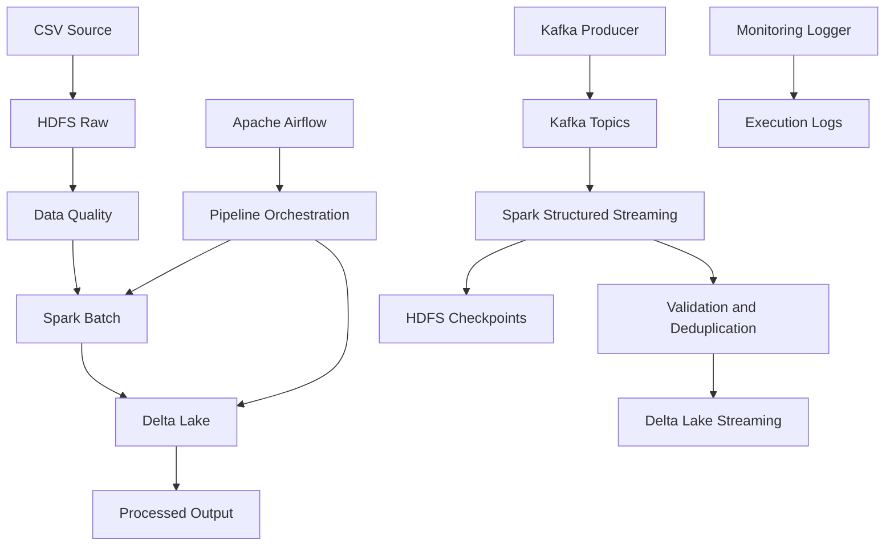

# E-Commerce Data Engineering Architecture

## Batch Processing
Raw CSV -> HDFS -> Data Quality -> Spark -> Delta Lake -> Output Validation

## Streaming Processing
Kafka Producer -> Kafka Topic -> Spark Structured Streaming -> Validation -> Deduplication -> Delta Lake

## Workflow Orchestration
Apache Airflow manages ecommerce_data_pipeline and ecommerce_generated_pipeline.

Each pipeline contains five tasks: Input Validation, Data Quality, Spark Batch, Delta MERGE, Output Verification.

## Monitoring
- Airflow success and failure callbacks
- Python rotating file logger
- Execution logs and data quality reports

## Storage Zones
- Raw: Original source datasets
- Generated: Synthetic datasets
- Processed: Spark transformation outputs
- Delta: Transactional processed data
- Streaming: Streaming outputs
- Checkpoints: Streaming recovery metadata

## End-to-End Architecture Diagram

